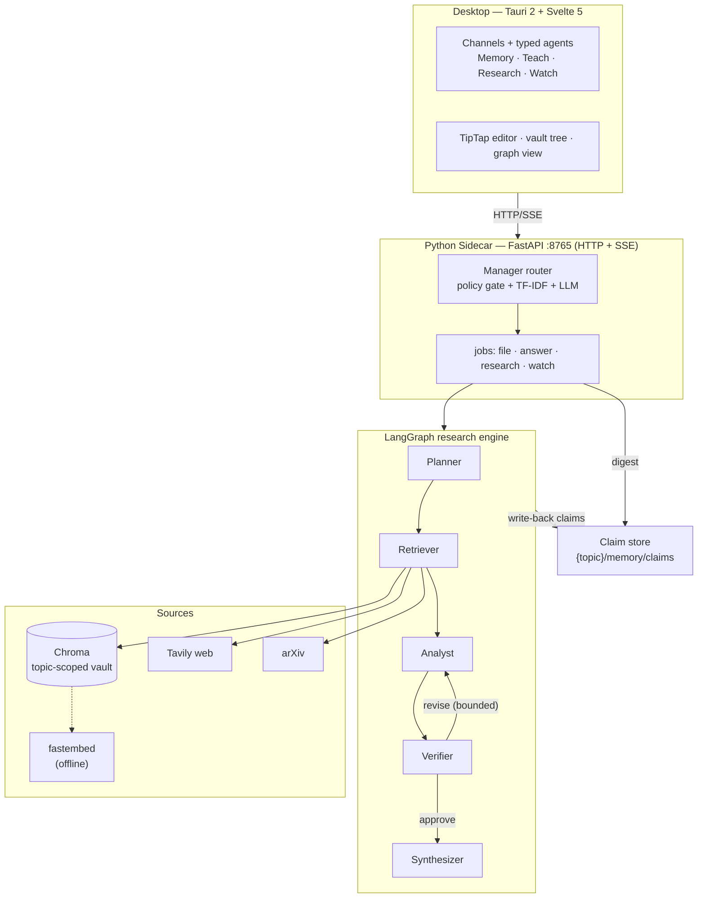
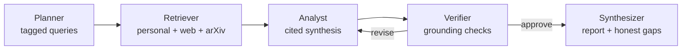
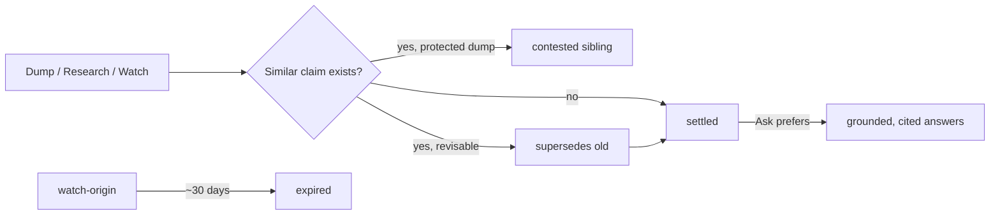

# Developing a Graph-Based Multi-Agent Framework for Autonomous Research and Lifelong Personal Knowledge Management

**Student Name:** Wong Yan Hao
**Student No.:** TP068819
**Programme:** B.Sc. (Hons) Computer Science (Artificial Intelligence) — APD3F2601CSAI
**Supervisor:** Mr. Amad Arshad
**Second Marker:** Ms. Mary Ting
**Institution:** Asia Pacific University *(APU logo top-right)*

---

## Introduction

**Nous** is a local-first second brain: a graph-based multi-agent system that researches autonomously, grounds every answer in the user's own topics, and files what it learns into durable, lifelong topic memory. It ships as a cross-platform desktop app where the user's knowledge stays on-device and the LLM is Bring-Your-Own-Key.

---

## Objective

**Aim:** To develop a graph-based multi-agent system of autonomous research and lifelong personal knowledge management that is a privacy preserving, local-first Second Brain of knowledge workers and students.

1. To create and deploy a LangGraph-based multi-agent architecture that uses persistent vector database memory, making it possible to retain personal knowledge throughout life and to be aware of context across sessions.
2. To incorporate real-time hybrid retrieval systems that smoothly integrate the personal documents of the user, web search APIs (Tavily) and scholarly archives (arXiv) into a single retrieval-augmented generation (RAG) pipeline.
3. To test system performance in terms of a curated benchmark of task completion rate, rate of hallucination, and citation accuracy against strong single-LLM baselines (Claude and Grok chat).
4. To roll out the solution as a cross-platform desktop application with Tauri 2.0, which offers native performance, local-first privacy, and optional Bring-Your-Own-Key cloud LLM access.

---

## Problem Statement

- Knowledge is scattered across chat apps, folders, and PDFs — general AI assistants cannot see it, cannot cite it, and forget every conversation.
- Cloud assistants raise privacy concerns: personal notes must not leave the device.
- Generated answers hallucinate without grounded sources or honest gap reporting.

An April 2026 survey (n = 62) confirmed knowledge workers and students want a private assistant that learns from their notes, cites its sources, and keeps memory local.

---

## Methodology

### Architecture

A Tauri 2 + Svelte 5 desktop shell talks to a local Python **FastAPI sidecar** (HTTP + SSE) that orchestrates the **LangGraph** research engine. Topic-scoped retrieval runs on **Chroma** with offline **fastembed** embeddings. Hybrid retrieval adds **Tavily** web and **arXiv** academic sources.

| Layer | Technology |
|-------|------------|
| Desktop | Tauri 2.0 (Rust) · Svelte 5 · SvelteKit · TipTap |
| Sidecar | Python 3.12 · FastAPI · Uvicorn (HTTP + SSE) |
| Orchestration | LangGraph state machine |
| Memory | Chroma vector DB (per-topic scope) |
| Embeddings | fastembed `BAAI/bge-small-en-v1.5` (offline) |
| LLM | Groq BYOK · Ollama / OpenAI / OpenRouter |
| External sources | Tavily web · arXiv API |

### Job routing

An invisible **Manager** routes each message to the right job — Teach, Ask, Research, Watch, or Refuse:

1. **Policy gate** (regex, deterministic): attachments force Teach; "according to my notes" forces grounded Ask; a general question on an empty topic triggers auto-research.
2. **Local ML router**: TF-IDF (1–3 grams) + logistic regression trained on **521 labelled turns** — held-out **macro-F1 0.937**.
3. **LLM arbitration** for ambiguity, with a deterministic fallback that keeps routing alive offline.

### Research pipeline

**Planner → Retriever → Analyst ⇄ Verifier → Synthesizer**

The **Verifier** self-critiques every draft with rule-based grounding checks and returns work for revision (bounded) before approval. Retrieval is **hybrid and personal-first**: topic-scoped personal documents, Tavily web, and arXiv — deduplicated, with automatic fallbacks when personal coverage is thin. Every report ends with an **honest gaps** section and a deterministic bibliography.

### Lifelong memory

Memory is a **claim store** per topic: atomic sentences with **status** (settled · contested · superseded), **origin** (dump · watch · research), and **provenance** (verbatim source quote, source path, content hash). Lifecycle: capture → consolidate → retrieve → reconcile → decay. User dumps are **protected** — Watch and Research may only add *contested siblings*, never silently overwrite. Watch-origin claims decay after ~30 days; dumps and settled research persist.

---

## Features

- **One channel = one lifelong topic folder** with its own vault memory — isolation by design.
- **Four typed agents per channel:** Memory (ask your notes) · Teach (dump notes → claims) · Research (autonomous cited reports) · Watch (scheduled briefs).
- **Agent interviews:** new agents ask "What do you want an assistant to do?" and bind themselves to a topic; empty channels are onboarded by interview, not forms.
- **Write-back:** research reports and watch briefs file provenance-tagged claims back into the topic.
- **TipTap markdown editor** with wikilinks, semantic vault search, and a memory graph view.
- **Evaluation results** — Ask mode: 100% task success, 80% citation rate, 100% gold-answer hits, 0% invented answers, ~25 s average. Research mode: 100% task success, 100% citation rate, 100% honest-gaps sections, ~20 citations per report, ~5.8 min average. Known limitations: two edge-case runs strayed outside vault scope — reported honestly.
- **Engineering quality:** ~450 automated tests (286 Python, 164 TypeScript); baseline comparison vs Claude/Grok chat; UAT with 5–8 participants.

---

## Conclusion

Nous delivers local-first multi-agent research with self-critique and a lifelong, claim-based topic memory — privacy-preserving by design, extensible by BYOK. Future work: Semantic Scholar integration, in-app claim-graph visualisation, scaled benchmarks and completed UAT, richer watch scheduling.

**SDG 9 — Industry, Innovation and Infrastructure:** Target 9.5 (scientific research & technological capability) · Target 9.b (domestic technology development).

**Keywords:** Multi-Agent Frameworks · Autonomous Research · Personal Knowledge Management · Retrieval-Augmented Generation · LangGraph · Second Brain

▢ **Scan for source code**  ▢ **Scan for 2-minute demo**
